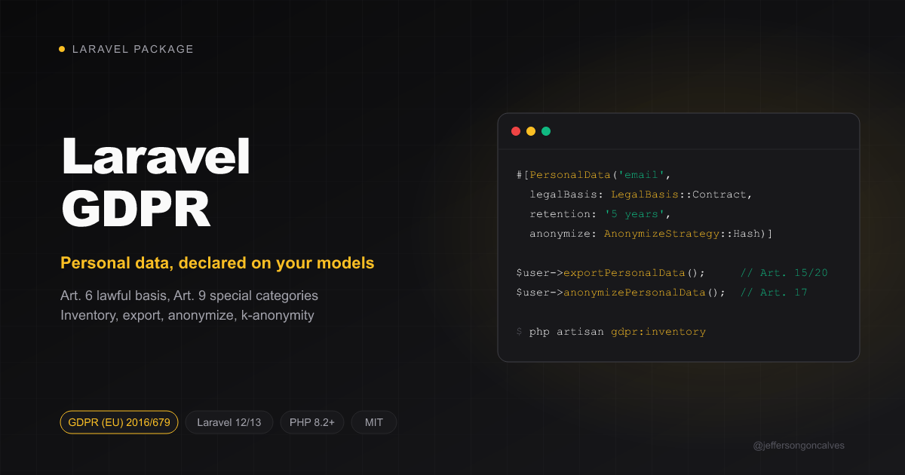

# Laravel GDPR



[](https://packagist.org/packages/jeffersongoncalves/laravel-gdpr)
[](https://github.com/jeffersongoncalves/laravel-gdpr/actions/workflows/tests.yml)
[](https://packagist.org/packages/jeffersongoncalves/laravel-gdpr)

Core of a toolkit for the EU General Data Protection Regulation (GDPR, Regulation (EU) 2016/679) in Laravel. You declare which columns of your Eloquent models hold personal data. With those declarations the package can:

- build the **personal data inventory** (data mapping that feeds the records of processing activities, Art. 30);
- **export** a record's personal data (right of access and data portability, Arts. 15 and 20);
- **anonymize** a record, choosing a strategy per column (right to erasure, Art. 17).

> This package gives you tooling. It does not make you compliant on its own. You still need legal review for lawful bases, retention periods and your privacy notice.

## Installation

```bash
composer require jeffersongoncalves/laravel-gdpr
php artisan vendor:publish --tag="gdpr-config"
```

## Declaring personal data

```php
use JeffersonGoncalves\Gdpr\Attributes\PersonalData;
use JeffersonGoncalves\Gdpr\Concerns\InteractsWithPersonalData;
use JeffersonGoncalves\Gdpr\Contracts\HasPersonalData;
use JeffersonGoncalves\Gdpr\Enums\{AnonymizeStrategy, DataCategory, LegalBasis};

#[PersonalData('name', purpose: 'Account identification', legalBasis: LegalBasis::Contract, anonymize: AnonymizeStrategy::Mask)]
#[PersonalData('email', legalBasis: LegalBasis::Contract, retention: '5 years', anonymize: AnonymizeStrategy::Hash)]
#[PersonalData('health_notes', category: DataCategory::Special, legalBasis: LegalBasis::Consent)]
#[PersonalData('tax_id', legalBasis: LegalBasis::LegalObligation, anonymize: AnonymizeStrategy::Keep)]
class User extends Authenticatable implements HasPersonalData
{
    use InteractsWithPersonalData;
}
```

Lawful bases (`LegalBasis`, Art. 6(1)): `consent`, `contract`, `legal_obligation`, `vital_interests`, `public_task`, `legitimate_interests`. Categories (`DataCategory`): `personal`, `special` (Art. 9) and `criminal` (Art. 10). Special categories also need an Art. 9(2) condition. Write it in the `purpose`.

Register the model in `config/gdpr.php`:

```php
'models' => [
    App\Models\User::class,
],
```

### Anonymize strategies

| Strategy | Result |
|---|---|
| `Nullify` (default) | `null` |
| `Hash` | HMAC-SHA256 keyed by `GDPR_HASH_KEY` (falls back to `APP_KEY`). It gives a stable pseudonym, so unique indexes keep working |
| `Mask` | `Maria Silva` → `M**********` |
| `Keep` | untouched, for data you must keep by law (e.g. tax records) |

Encrypted casts (`'encrypted'`) work as expected: the value is decrypted, then anonymized, then encrypted again.

## Usage

```php
use JeffersonGoncalves\Gdpr\Facades\Gdpr;

Gdpr::inventory();                 // one row per declared column
$user->exportPersonalData();       // ['name' => ..., 'email' => ..., ...]
$user->anonymizePersonalData();    // applies each strategy and saves
```

`anonymizePersonalData()` fires `JeffersonGoncalves\Gdpr\Events\PersonalDataAnonymized` with the model and the columns it changed. Columns marked `Keep` are not in that list. [laravel-gdpr-retention](https://github.com/jeffersongoncalves/laravel-gdpr-retention) listens to it to write tombstones. With those, it can erase again any data that a backup restore brings back.

```bash
php artisan gdpr:inventory          # table
php artisan gdpr:inventory --json   # machine readable
```

## k-anonymity

Before you share or publish a dataset as anonymous (Recital 26), check that nobody can be singled out by combining quasi-identifiers such as ZIP code, birth date and gender. A dataset is *k*-anonymous when every combination of those values is shared by at least *k* rows. It is *l*-diverse when each of those groups also holds at least *l* distinct sensitive values.

```php
use JeffersonGoncalves\Gdpr\Facades\Gdpr;
use JeffersonGoncalves\Gdpr\Generalize;

Gdpr::kAnonymity(Patient::class, [
    'zip' => Generalize::prefix(3),         // 10115 → 101
    'birth_date' => Generalize::date('Y'),  // 1990-03-01 → 1990
    'age' => Generalize::range(10),         // 34 → 30-39
    'gender',                               // as stored
], k: 5, sensitive: 'diagnosis');

// ['rows' => 1200, 'groups' => 87, 'k' => 3, 'rows_below_k' => 14, 'l' => 1]
```

`k` is the smallest group, `rows_below_k` counts the rows you still need to generalize further or suppress, and `l` is the smallest number of distinct sensitive values in a group. It accepts a model class or a query builder. Values are read through the model, so casts apply. The generalizers are plain closures, so you can also use them to build the dataset you export.

```bash
php artisan gdpr:k-anonymity "App\Models\Patient" zip birth_date --k=5 --sensitive=diagnosis
```

The command fails (exit code 1) when the data is below the target *k*, so it can run in CI or before a scheduled export. It scans every row, so run it off-peak on big tables.

## Testing

```bash
composer test
```

## Changelog

See [CHANGELOG](CHANGELOG.md).

## License

The MIT License (MIT). See [License File](LICENSE.md).
